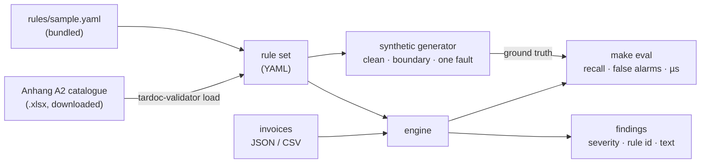

# tardoc-validator

[](https://github.com/riccardito/tardoc-validator/actions/workflows/ci.yml)

[](LICENSE)

**Checks a Swiss outpatient service list against the TARDOC tariff rules and says, in plain words, what is wrong.**

## What this is, and what you can do with it

A Python library and command-line tool for one job: take the services billed to a patient — tariff positions, quantities, dates, sessions — and tell you, before the invoice leaves, whether TARDOC's rules allow them together, and if not, which rule breaks and why.

- **Check an invoice:** `tardoc-validator validate invoices.json` (or `.csv`), findings as text or JSON.
- **Show it live:** `make serve` opens a local page where you type the positions someone names, or draw a random case, and see the verdict.
- **Measure it:** `make eval` runs 1 000 synthetic invoices with known faults and prints recall, false alarms and runtime against a baseline.
- **Use the full tariff:** `make eval-official` loads the official catalogue you download and runs the same checks over all 1 388 positions.
- **Build on it:** the rules are YAML and the engine is 130 lines — add a rule kind, plug it into a billing pipeline, or put an explanation layer on top.

## The problem

Since 2026 Swiss outpatient medicine bills under TARDOC: about 1 400 positions, each with its own limits, exclusions and conditions. A wrong combination is not caught when the service is recorded — it comes back weeks later as a rejected invoice. The rules are published, but as lines of German text in an Excel column, not as something a program can check.

## The result

The rules become data; a small engine checks them; a synthetic test suite with known faults measures it.

| On 1 000 synthetic invoices (seed 7) | Recall | False alarms | Per invoice |
|---|---:|---:|---:|
| **this engine**, bundled rule set (23 positions) | **100.0 %** | **0.0 %** | 13 µs |
| baseline: quantity per session only | 8.4 % | 0.0 % | 2 µs |
| **this engine**, the full official catalogue (1 388 positions) | **100.0 %** | **0.0 %** | 16 µs |

The suite holds 415 clean invoices, 84 *boundary* invoices that sit exactly at a limit — the false-alarm probes — and 501 with one injected fault of thirteen kinds. Timings are from one laptop run and vary by machine. The baseline is the check most billing software starts with. It catches one fault in twelve.

A perfect score is only worth something if a broken engine would not get one. So the tests plant bugs: an off-by-one on an age boundary, a window one day too wide, a dropped cumulation check, a dropped add-on check. Each one moves a number, and CI fails if it ever stops doing so.

## Quickstart

```bash
git clone https://github.com/riccardito/tardoc-validator && cd tardoc-validator
python -m venv .venv && . .venv/bin/activate   # Windows: .venv\Scripts\activate
make install && make demo && make eval
```

```
A-1001: OK
A-1002: 6 finding(s)
  [error] AA.00.0010/not-with: AA.00.0010 and AA.00.0030 may not be billed in one session; each position's rules exclude the other (AA.00.0010/not-with, AA.00.0030/not-with)
  [error] AA.00.0040/addon-without-parent: AA.00.0040 is an add-on to AA.00.0030, and none is billed in session 2
  [error] AA.00.0040/max-per-session: AA.00.0040 billed 18 times in session 2; the limit is 15
  [error] AG.00.0010/side-missing: AG.00.0010 needs the side (L, R or B)
  [error] CG.00.0010/age: CG.00.0010 requires age <= 16 years; not met on 2026-02-04
  [error] GK.10.0050/sex: GK.10.0050 is for female patients only
```

Input is JSON or CSV — one row per service, with the patient's birth date and sex. `tardoc-validator validate --json` gives the findings as data; the exit code is 1 when an invoice has an error.

## Live demo

```bash
make load CATALOGUE=Anhang_A2_Katalog_des_TARDOC_1.4c.xlsx   # once: the full tariff, local only
make serve                                                    # http://127.0.0.1:8000
```

The page takes a patient (birth date, sex) and the services. Type them one per line — `AA.00.0010`, `AA.00.0020 x10`, `AG.00.0010 R`, `@2` for a second session — or fill the table, then press **Check**. Codes autocomplete from the catalogue with their official titles. **Random case** draws a generated invoice that is clean, sits exactly at a limit, or carries one planted fault, and after the check the page says what was planted, so an audience can see the engine find it. Without the catalogue the page runs on the 23-position sample. Nothing leaves the machine.

## How it works



**Rules are data.** One YAML entry per position: quantity limits per session, day, patient or rolling window; positions or chapters it may not be billed with; the only positions it may be billed with; the parent an add-on needs; sex and age conditions; whether the side must be given. The engine has one small function per rule kind, so every finding names the rule that made it. When two positions ban each other, the combination is one finding that names both rules; in TARDOC 1.4c that is 3 356 of the 3 428 banned pairs (97.9 %), so without it nearly every cumulation error would be reported twice.

**The loader** reads the official catalogue's rule column and parses ten line shapes. On TARDOC 1.4c it turns 57.4 % of the 10 703 rule lines into rules; 11.1 % are permissions ("may be combined with"), which restrict nothing. 31.4 % are not supported yet, almost all of them rules over *Leistungsgruppen* (groups of positions). It prints those shares every time it runs.

**The generator** writes invoices it knows the answer to. It builds a clean invoice by construction, then breaks exactly one rule. Its date arithmetic and code matching are written separately from the engine's, so a shared bug cannot hide.

## The data

The official catalogue is not in this repository. It is published by OAAT AG; download *Anhang A2, Katalog des TARDOC* and run `make eval-official CATALOGUE=<file.xlsx>`. The output goes to `rules/official/`, which git ignores, and CI checks that no catalogue file is ever committed.

`rules/sample.yaml` is a hand-written rule set over 23 real positions. Its rule facts were read from the published catalogue; its titles are short English descriptions written for it. It is a test fixture, not a billing reference.

## What I learned, and what is open

**The full catalogue found a bug the sample never could.** The first run over all 1 388 positions reported 6.8 % false alarms. The engine was right: the generator added age-restricted add-ons without checking the patient's age. The bundled rule set has no such add-on. Testing against the real data is what made the test data honest.

**100 % recall here measures fidelity, not truth.** It says the engine applies the rules as written. Whether the rules as written match what an insurer rejects needs real invoices and real rejections, which a public repository cannot have.

**One reading is mine.** The catalogue writes `<= 16 Jahre (+0 Tage)`. I read that as "on or before the 16th birthday, moved by the tolerance in days". The engine states the reading in its docstring, and the boundary probes test exactly that day.

Open:

- Leistungsgruppen — the 31 % — need the group sheet. They are the next rule kind.
- Units beyond session, day and patient: per side, per main service, per sample.
- The Generalinvoice XML input of Forum Datenaustausch, and an LLM that explains each finding in billing language, quoting the rule. The engine decides; the model only explains.

This is a portfolio project, not a certified validator.

## Author

Built by Riccard Nef, AI engineer in Swiss healthcare IT — [LinkedIn](https://www.linkedin.com/in/riccard-nef-62683511b/) · [*The Agora Method*](https://medium.com/@stillwaiting/the-agora-method-b62263bde400).

## Licence

MIT for the code — see [LICENSE](LICENSE). The TARDOC catalogue belongs to its publisher and is not distributed here.
